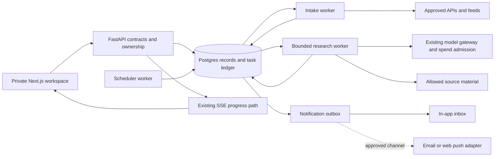

# Architecture and technology

Date: 2026-11-02. Status: proposed implementation direction. The interfaces
below are design contracts for new work, not descriptions of shipped endpoints.

Build a private daily research workspace on the existing Next.js, FastAPI,
LangGraph, Redis and Postgres foundation. Add durable intake, schedules,
personal relevance, source identity, reading state and evidence-backed research
artifacts. Keep the existing research and guided-reading surfaces reachable.
The owner selected **daily briefing plus guided deep dives** and **local first,
with paid services approved separately**. A useful metadata briefing, manual
reading and notes therefore precede paid model generation. Hosted operation is
an optional later decision, not an initial dependency.

## Existing components to reuse

| Existing component | Reuse | Required delta |
|---|---|---|
| `web/` Next.js application, design tokens, Radix patterns, TanStack Query | Private responsive frontend, same-origin proxy, asynchronous jobs and source panels | Today, Radar, item detail, interests, library and research-project surfaces; preserve mobile and accessibility budgets |
| `src/api/routes.py`, `jobs.py`, `runner.py`, `streaming.py` | Job lifecycle, ownership, cancel, SSE, history and exports | Typed new job kinds and admission policies; do not disguise intake/digest work as user research jobs |
| `src/api/redis_store.py`, `redriver.py` | Existing job records, leases and UI progress distribution | An orphaned running job currently fails rather than safely resuming paid work. Add explicit per-stage replay semantics |
| `src/tools/postgres_pool.py` and existing stores | Connection handling, ownership patterns and durable relational state | Versioned migrations and new domain repositories; do not grow one unreviewable `SCHEMA_DDL` block |
| `src/agents/`, `src/graph/workflow.py`, `src/llm.py` | Reader, synthesis, critique, LangGraph, model-aware gateway and usage metering | Bounded, evidence-backed briefing/deep-dive policies with the task's source and cost scope |
| `src/contracts/`, `src/campaign/`, `src/eval/` | Identity, artifacts, provenance, evaluation and failure vocabulary | Apply only the required launch gates in document 06; repair identified integration defects before making quality claims |
| `src/tools/pdf_parser.py`, chunker/ranker, paper/embedding cache | Existing PDF and retrieval path | Preserve page/section/offset provenance and parser version independently of whether a policy enables evidence claims |
| `src/learning/` and session graph | User-declared study context, bounded explain/read/discuss interactions | Research interests are a separate preference model; do not infer mastery or rewrite declared profile fields from clicks |

The local checkout was reviewed at `dbd4bb8`; GitHub's six subsequent commits
end at `88d283d`. The implementation agent must establish its branch/head and
read the dated review before choosing a base. This kit does not authorize
overwriting local changes or assume that an old status page is current.

## System boundary

Postgres is authoritative for subscriptions, due work, durable artifacts and
delivery intent. Redis remains useful for existing jobs, locks/rate limits and
live progress; a transient pub/sub message is not the durable record of a
digest or a scheduled run. Keep intake, model work and delivery as separate
stages so each can retry or stop without replaying the others.

## Recommended technology decisions

| Decision | Initial choice | Add a different tool only when |
|---|---|---|
| Web framework and UI state | Existing Next.js/React, tokens and query library | A measured capability gap requires it; no frontend rewrite |
| Durable database | Existing Postgres/psycopg | Multi-region or other measured operating requirements justify a change |
| Feed parsing | Small `feedparser` dependency, pinned and audited; parse bytes obtained through the safe HTTP client | Adapter fixtures demonstrate an unmet format requirement |
| Scheduler and worker queue | Postgres due-work tables, short database leases and a separate worker command | Queue throughput/operational requirements justify Celery, Dramatiq, Temporal or managed orchestration |
| Search | Postgres full-text search and filters; retain existing embeddings for selected documents | A relevance benchmark demonstrates semantic misses; then evaluate pgvector in the same DB before a separate vector service |
| Agent runtime | Existing bounded LangGraph workflows | A new framework wins an explicit maintainability/reliability comparison |
| PDFs | Existing PyMuPDF path with extraction-quality status | A representative scientific-table/formula test establishes the need for OCR, GROBID/Docling or another parser |
| Article text | Metadata/link-out first; allowlisted extraction adapter with exact source/version identity | Full-text rights and extraction fixtures pass; no general headless crawler at launch |
| Graph relationships | Postgres edge table with provenance/type | A real query workload needs a dedicated graph engine |
| Notifications | In-app delivery first; one owner-selected external adapter next | A second channel is actually used; no email/push/chat platform fleet upfront |
| Binary/source artifacts | Local private volume for local mode; existing approved host volume for private hosted mode | Object volume, backup or multi-worker needs justify S3-compatible storage |
| Schema changes | Versioned SQL migrations with checksums and a schema revision table | ORM/migration tooling requirements justify a new abstraction; no ORM prerequisite |

Postgres supports queue-like consumers through `FOR UPDATE SKIP LOCKED`; keep
the transaction short and handle application-level replay. Its built-in
full-text search supports GIN indexes, so an external search cluster is not a
launch dependency. [Postgres SELECT](https://www.postgresql.org/docs/current/sql-select.html),
[text-search indexes](https://www.postgresql.org/docs/16/textsearch-indexes.html)

Feed conditional requests should use stored ETag and Last-Modified validators.
Fetch through a controlled HTTP layer, then pass bounded bytes to the parser;
do not let a parsing library bypass outbound-request policy.
[Feedparser conditional requests](https://feedparser.readthedocs.io/en/latest/http-etag/)

pgvector can combine vector retrieval with Postgres full-text search. Treat
that as a measured next step; an embedding match is a relatedness candidate,
not evidence that one scientific claim supports another.
[pgvector hybrid search](https://github.com/pgvector/pgvector#hybrid-search)

## Durable data model

Use UUIDs or the project's existing stable-id convention internally. Separate
logical works from provider records, published versions and user state.
Public metadata can be shared internally; private collections, notes,
interests, read history, project hypotheses and conversations always retain
principal scope, including in the first single-user version.

| Record | Required fields and invariant |
|---|---|
| `interest_profile` / `interest_revision` | Owner, revision, selected topic IDs, custom concepts, exclusions, languages, study level, goals, exploration allowance, time budget, ranking-policy version. Explicit changes create a revision |
| `watch` | Owner, scope (topic/query/author/venue/repo/model/project), normalized query, source set, cadence, enabled state, created/edited dates. A watch can preview matches before enabling |
| `source_connector` | Adapter kind/version, approved endpoint/host rules, credential reference, source category, rights policy, health state, last successful check, retry-after, cursor and conditional-fetch validators |
| `ingest_run` | Connector and query revision, requested and completed windows, cursor start/end, timestamps, item counts, gaps/errors, quota and cost. Cursor advances only with committed observations |
| `source_record` | Provider ID, URL, raw metadata hash, observed time, published/updated time with precision/timezone, adapter revision, provenance and rights/access state |
| `work` | Canonical identity plus aliases (DOI, base arXiv ID, PMID, OpenAlex ID, canonical URL). A title match alone never silently merges two works |
| `work_version` | Source-specific version/ref, content hash, submitted/published/updated/observed times, correction/retraction state and links to previous version. Versions are immutable |
| `resource_link` | Typed paper-to-repository/model/dataset/discussion/review link; how it was found, asserted-by, observed time, confidence category and verification status. A claimed official repo remains a claim until verified |
| `story_cluster` / `cluster_member` | A user-visible event/theme and its distinct source versions; exact-identity matches separate from semantic clustering. Related coverage remains individually inspectable |
| `source_material` / `source_span` | Work version, acquisition time/method, allowed use, scope (`metadata`, `abstract`, `excerpt`, `full_text`), parser revision, hash, page/section/offset, extraction quality. Preserve independent of policy flags |
| `relevance_assessment` | Item/cluster, profile revision, candidate-generation policy, positive and negative reason codes, component scores, novelty and diversity signals, assessed time. User can inspect why it appears |
| `reading_state` / `feedback_event` | Owner, work/version/cluster, seen/opened/saved/dismissed/read state and optional explicit usefulness/reason. Opening is not proof of understanding; dismissal is not automatically a negative label for the field |
| `digest` / `digest_revision` | Owner, window, profile revision, cutoff, source-coverage receipt, ordered item IDs/versions, generation version, state and costs. Revising it creates a new revision; yesterday's briefing does not silently mutate |
| `research_project` | Owner, question, declared goal, prerequisite concepts, sources, notes, open questions, links to deep dives and proposed experiments, status. No arbitrary tool permission is implied |
| `research_artifact` / `claim_evidence` | Artifact kind/revision, material refs, structured claims and span refs, evidence status, model/prompt/tool/config identity, contradictions/limitations, human edits and supersession |
| `hypothesis` / `experiment_plan` | Owner, premise, motivating evidence, competing explanation, falsifier, baseline, proposed method, data/compute assumptions, risks and next action. Explicitly speculative until tested |
| `schedule` / `scheduled_occurrence` | Owner, IANA zone, local cadence, next due UTC, configuration revision, missed-run policy; unique occurrence key and durable task link |
| `work_task` / `task_attempt` | Kind, stage input digest, state, priority, due time, attempt count, lease owner/expiry, budget reservation, checkpoint/artifact ref and terminal reason |
| `delivery_outbox` / `delivery_attempt` | Digest/item ref, owner-approved channel, destination reference, occurrence key, idempotency key, state, attempts, accepted/unknown/failed outcome and provider receipt |
| `budget_policy` / `spend_reservation` | Owner and period, currency/price revision, approved ceiling, reserved/spent/uncertain amounts, job allocation, approval provenance and reconciliation timestamps |

Keep raw publisher payloads only under a documented retention policy; store
bounded normalized records and digests when source terms do not allow text
retention. Deleting a private project removes its derived private indexes and
artifacts, while shared public identifiers can remain without the user's
association. Test those deletion semantics rather than promising universal
deletion of third-party or Git history.

## Lifecycle contracts

Intake follows `due -> fetched -> normalized -> identity-resolved -> stored`.
An item may then be `metadata_only`, `material_ready`, `extraction_partial`,
`access_unavailable` or `quarantined`. Ranking and reading state are independent
of these access states.

A digest follows `planned -> collecting -> ranking -> drafting -> checking ->
ready`. Terminal alternatives are `ready_partial`, `failed`, `cancelled` and
`budget_stopped`. A digest can be useful with metadata cards and no generated
summaries. Do not use an unqualified “complete” when one connector failed.

A deep dive follows `requested -> scope_review -> acquiring -> analyzing ->
checking -> ready`, with the same explicit partial/failure stops. Save scope,
material, analysis and check artifacts at stage boundaries. An idea follows
`proposed -> user_selected -> experiment_planned -> tested` with test evidence;
no agent can advance it to “validated” merely by agreeing with it.

Every generated factual statement references a material version and one or
more spans. Reasoned connections have separate `relation_kind` values:
`citation`, `shared_method`, `shared_benchmark`, `prerequisite`, `reported_conflict`
or `hypothesized_transfer`. Distinguish author-reported results, external
replication, the agent's interpretation and the user's own hypothesis.

## Intake and relevance pipeline

1. Query approved APIs/feeds within configured source and time windows. Store
   event time and first observation separately; a late-indexed old paper is
   “newly discovered”, not “published today”. Use overlap windows so late
   indexing does not disappear between polling intervals.
2. Resolve hard identifiers and versions, then cluster coverage of one event.
   DOI/arXiv version normalization, URL tracking cleanup and syndication rules
   are deterministic. Ambiguous title/author matches require a merge candidate.
3. Produce candidates from explicit interests, exact watches and optional
   semantic matches. Enforce source/language/date/exclusion constraints first.
4. Rank using a versioned, inspectable policy: declared relevance, newness to
   the user, source type, relation to active projects and diversity. Popularity
   can inform discovery; it is not a factual-quality score.
5. Reserve a configurable exploration lane for adjacent work and prerequisites.
   Show the connecting topic/project. Users can turn this down without muting
   their core interests or accepting opaque profiling.
6. Spend model calls only on a bounded shortlist or requested deep dive. Cache
   by source version, material digest, requested depth and model/prompt policy.
   Do not regenerate identical paper summaries for each watch.

Suggested initial controls for the owner workshop: a daily reading-time target,
digest item limit, source-type mix, “frontier versus foundations” mix, duplicate
policy, immediate-alert criteria and per-period generation ceiling. These are
editable product settings, not permanently learned weights.

## Durable scheduling and delivery

Run a separate scheduler worker in Compose, not a browser timer or a
request-scoped FastAPI background task. FastAPI's own documentation separates
small in-process background actions from heavier distributed work; this app
also needs persistent due work and recovery. [FastAPI background tasks](https://fastapi.tiangolo.com/tutorial/background-tasks/)

- Store schedules as an IANA zone plus local wall-clock time; derive UTC
  occurrences with Python `zoneinfo`. Define non-existent times as “next valid
  local instant” and repeated times as one first occurrence, recording which
  offset was selected. These are proposed product semantics to pin in tests.
  [Python zoneinfo](https://docs.python.org/3/library/zoneinfo.html)
- Use a unique `(schedule_id, local_date, occurrence_kind)` occurrence key for
  daily briefs and store the applied schedule revision on that occurrence.
  A schedule edit never creates a second automatic delivery for the same
  logical digest without an explicit resend action. Explicit reruns/resends
  have their own lineage and keys instead of changing this uniqueness rule.
- In one short transaction, claim due rows with `SKIP LOCKED`, insert the
  occurrence/task if absent, set its lease and compute the next due time.
  Release DB locks before network calls or LLM work. Lease heartbeats and
  compare-and-swap completion prevent a stale worker from publishing twice.
- Persist task stage outputs and input hashes. Retrying intake reuses source
  IDs; retrying a generated artifact reuses a completed artifact; an interrupted
  provider call with unknown billing remains “uncertain” until reconciled.
- Commit digest readiness and outbox intent in the same transaction. A delivery
  worker consumes intent and records provider acceptance separately from user
  receipt. An accepted email is not proof it was read.
- External delivery is at least once with application idempotency; do not
  claim universal exactly-once delivery. If a provider lacks reliable retry
  idempotency and acceptance is unknown, surface that outcome before resend.
- Bound retries, use jitter and Retry-After, dead-letter persistent failures,
  and provide manual replay with a reason and preserved lineage.
- Local asleep/offline policy: on next start, collect the missing window and
  create one catch-up digest capped by item/time budget; do not emit a backlog
  of missed push/email alerts. Show the missed interval and current coverage.
- Pause/disable stops future occurrences and queued deliveries. Cancellation
  of a running generation uses the existing cooperative token and preserves
  already incurred spend.

Redis Streams are a future queue alternative with pending-message recovery and
acknowledgment, but they still require idempotent application side effects.
Do not introduce Streams alongside a new Postgres queue unless one is clearly
authoritative. [Redis Streams](https://redis.io/docs/latest/develop/data-types/streams/)

## Proposed API contracts

All mutations retain the existing principal checks, same-origin proxy and
typed error envelope. Add OpenAPI-generated TypeScript types in the same PR.
List endpoints use stable cursor pagination and an `as_of` cutoff. Mutation
requests accept an idempotency key; edits carry a revision/If-Match guard.

| API surface | Behavior |
|---|---|
| `GET /topics?parent_id=&q=` | Versioned topic navigation plus source-coverage state; custom topics remain possible |
| `GET /interests`, `PUT /interests` | Read/update the owner's profile revision and explicit goals/exclusions |
| `POST /watches/preview` | Bounded, read-only match preview; show sources queried and possible matches before enabling |
| `GET/POST/PATCH /watches` | Manage typed watches, cadence and enabled state; no implied external delivery |
| `GET /sources`, `PATCH /sources/{id}` | Coverage/health and owner-managed allowlisted source settings; keys are secret references |
| `POST /sources/{id}/refresh` | Enqueue bounded connector work; 202 plus job/coverage receipt |
| `GET /items?...`, `GET /items/{id}` | Cards/detail with canonical/version IDs, source links, dates, scope, cluster and relevance reasons |
| `PUT /items/{id}/reading-state`, `POST /feedback` | Explicit owner state and optional feedback; idempotent events with undo |
| `GET /digests`, `GET /digests/{id}` | Historical immutable revisions and the coverage cutoff behind each briefing |
| `POST /digests` | Request one bounded digest; 202, estimated work and admission status, then job SSE |
| `GET/PUT /alert-preferences`, `GET /alerts` | In-app inbox, quiet hours, frequency, immediate-event rules and reviewed channel state |
| `GET/POST/PATCH /research-projects` | User questions, notes, goals, evidence and proposed experiments |
| `POST /deep-dives` | Declared question, selected item versions, depth, tools and approved ceiling; 202 or scope-review job |
| `POST /research-projects/{id}/ideas` | Produce labelled hypotheses and falsifiable plans from selected evidence; no code execution |
| `GET /operations`, `GET /usage` | Owner view of next check, connector gaps, queued work, costs, reservations and cap state |

Proposed new refusal reasons include `source_not_allowed`,
`source_material_unavailable`, `source_scope_insufficient`, `coverage_partial`,
`budget_not_approved`, `budget_reservation_refused`, `schedule_revision_conflict`,
`delivery_destination_unverified`, and `idempotency_conflict`. Map these into
the existing error taxonomy through an ADR; do not scatter raw exception names
through the UI. A partial result is a typed success with disclosed gaps, not a
generic server error.

## Security and agent tool scope

Launch research tools are read-only: search approved sources, fetch bounded
material, inspect citation/repository/model metadata, retrieve a saved span,
write a private research artifact and propose a plan. Repository/model links
open for the user; the agent does not clone, run, install or send data to
arbitrary repositories as a side effect of reading an article.

All fetched content is untrusted data. It cannot alter tool allowlists,
interest settings, schedules, notification destinations, budget approvals or
system instructions. Tools validate typed arguments, principal scope and cost
again at execution time. Network fetches enforce allowed schemes/hosts,
redirect-hop validation, public-address rules after DNS resolution, size/time
bounds and a separate policy for explicitly configured local endpoints.
[MDN SSRF defenses](https://developer.mozilla.org/en-US/docs/Web/Security/Attacks/SSRF)

Retain the existing markdown safety/CSP approach. Sanitize article rendering,
never run publisher scripts, and isolate expensive document parsing from API
workers with process/resource limits. PyMuPDF exposes positioned text and OCR
facilities, but extraction order and OCR quality still require validation.
[PyMuPDF text extraction](https://pymupdf.readthedocs.io/en/latest/recipes-text.html),
[OCR API](https://pymupdf.readthedocs.io/en/latest/page.html#get_textpage_ocr)

## Deployment choices and later triggers

Local mode uses the existing Compose stack and a worker on the owner's
computer. Use an explicit local operator principal through the existing
server-only API-key proxy and a local overlay, keeping service ports on
loopback; OIDC/public signup is unnecessary for this mode. Preserve the
existing auth-off fixture demo as a separate configuration. Local mode is
useful while awake and cannot promise alerts while the machine sleeps.
Private hosted mode adds an always-on worker on an approved host, HTTPS,
protected operator access, backups and delivery health. Do not treat a laptop
browser tab as a scheduler.

Browser push adds a service worker, subscription storage, server delivery,
explicit permission and secure-context requirements. It is not a substitute
for an always-on ingestion worker. Ship responsive in-app alerts first, then
the one chosen external channel. [Service Worker API](https://developer.mozilla.org/en-US/docs/Web/API/Service_Worker_API)

Multi-user accounts/MT-01, arbitrary code execution, broad live-browser agents,
training, autonomous experiment execution and a dedicated graph database are
separate phases. Preserve seams for them without making them prerequisites
for a daily personal workspace.
