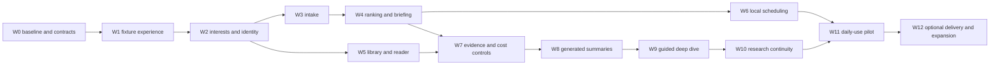

# Build sequence and work orders

Status: proposed implementation plan, 2026-11-02. The product goal and local
operating boundary are decided; numerical gates in [06](06-quality-cost-and-operations.md)
are initial acceptance proposals to ratify through concrete owner reviews.
The agent should split any card that becomes too large to review. No card
implicitly enables model spending, external delivery or hosting.

## Milestones and dependencies

There are three tangible releases: **Q0 fixture workspace**, **Q1 useful live
local metadata/reading workflow**, and **Q2-Q3 approved generated briefings plus
guided deep dives**. Q1 is an independent usable milestone, not a substitution
for the owner's requested agent-assisted destination. Q4 governs unattended
delivery; Q5 is the 14-day personal pilot. Work on reversible prerequisites
continues while a paid feature awaits an exact budget decision.

## W0 Establish the baseline and implementation contract

**Scope:** inspect local and remote branch/head, dirty files and local agent
rules; reconcile `dbd4bb8` with the six commits through `88d283d` or the newer
verified remote head; work on an isolated `codex/` branch/worktree. Preserve
the incoming kit and existing changes. Review the current dependency audit,
Python CI cancellation and the dated review. Record a new ADR for personal
daily-workspace direction, actor scope and initial route/job contracts.

**Acceptance:** report the chosen base and relevant gate results; current
high/critical production dependency entries are fixed or explicitly confined
to a non-running design-only preview while remediation proceeds. Never weaken
the audit to obtain green. Existing demo/auth modes remain testable; the new
personal-local mode uses an explicit principal and loopback-only boundary.
Use repository-supported Next.js documentation before implementation.

**Owner review:** show a concise baseline and direction decision record.
Do not ask the owner to approve hypothetical deployments or every dependency.

## W1 Build one coherent fixture experience

**Scope:** implement Today, interest selection, item detail/reader and saved
question flow using the existing UI primitives and design system. Use the
clearly fictional scenario in [10](10-example-briefing.md). Include one source
outage, abstract-only state, generation disabled and mobile behavior. Keep
existing research routes discoverable. Generated states may be explicitly
labelled fixtures; do not call real models to decorate a prototype.

**Acceptance:** owner can choose a lens, inspect why an item appeared, navigate
to its source, save a note/question, return to Today and find it. Test at
390 px and desktop, keyboard-only, back/forward navigation and failed source.
No irrelevant dashboard metrics, dead controls or invented source history.
Stories, route types, targeted interaction/axe checks and relevant budgets
pass. Present screenshots and a runnable walkthrough for visual review.

**Owner review:** this is the first substantial experience review. Ask about
information density, daily usefulness and deep-dive interaction; incorporate
feedback before expanding navigation.

## W2 Persist interests and canonical records

**Scope:** migrations and repositories for interest revisions, watches,
source observations, works/versions, resource links, source health and personal
state. Load the versioned topic seed with authored/external distinctions and
coverage state. Add the narrow API/contracts needed by W1. Do not build every
future project/graph table before it is used.

**Acceptance:** every selection round-trips; aliases and custom topics remain
valid; exclusions take priority; revision conflicts are explicit. DOI/arXiv
versions reconcile through reviewed identity rules. Ambiguous title matches
remain separate. Q0 checks cover the mixed identity/date fixture set. Topic
counts never masquerade as connected source counts. Migrations and data
exports have a documented rollback/restore path.

## W3 Ingest real bounded source metadata

**Scope:** safe network adapter contract, one shared host rate governor,
conditional requests, bounded retries, cursor/watermark with overlap, and
ingestion receipts. Reuse arXiv; add a small audited feed parser and a few
owner-selected primary feeds. Manual DOI/arXiv/URL save returns available
metadata or an honest link-only record. No broad crawler or unlimited backfill.

**Acceptance:** genuine source records enter the same views as fixtures with
their provenance preserved. Test duplicate pages, delayed updates, absent
dates, redirects, malicious feed markup, quota exhaustion, network failure and
crashes around commit/cursor advancement. Rerun produces the same logical
items. Coverage gaps appear on the digest. Q1 intake acceptance passes before
marking an adapter connected. Source URLs and free quotas are re-verified at
activation; no paid connector is silently selected.

## W4 Produce the daily briefing and transparent ranking

**Scope:** candidate filters, exact duplicate grouping, clearly labelled
related-story clustering, deterministic relevance components, exploration
allocation, explicit feedback and finite digest revisions. Metadata/source
abstract mode needs no inference. Add selected source coverage and cutoff to
every edition. Preserve a historical digest when preferences change.

**Acceptance:** compare chronological, keyword and proposed ranking on the
same candidate window. Owner supplies initial usefulness labels; record top-10
usefulness, missed relevant items, duplicates, exclusions and diversity. Do not
promise a universal score from one user's labels. Source failure yields a
usable partial edition, distinct from no new results. Saving/dismissing and
undo change only intended personal state. Cached summaries are never labelled
freshly checked when the source refresh failed.

## W5 Finish library and manual reading continuity

**Scope:** reading queue/collections, original-source link, accessible source
view for available material, notes/annotations, selections and last-read
anchor. Add Markdown/citation export in a standard interoperable format. Keep
full-text parsing bounded and permission-aware; existing PDF path is the
starting point. Standard import is read-only into this application initially.

**Acceptance:** closing/restarting restores notes and location against the
correct source version. User text survives parser/provider/source failure.
An unavailable PDF remains link/abstract-only. The app distinguishes source
deletion, note deletion and archive, and scoped export/import preserves IDs,
authors and notes. Handle scanned or mathematically dense documents with an
extraction-quality warning; do not add OCR services before testing that need.

## W6 Make local schedules and catch-up durable

**Scope:** Postgres schedule/occurrence/task ledger and separate Compose
worker; local IANA time, DST semantics, short leases, bounded retries and a
single catch-up edition. In-app alert intent is committed with digest readiness.
Separate scheduled metadata intake from optional generated analysis and
external delivery. Add an operations view for last success, next check and gaps.

**Acceptance:** two workers, both DST transitions, schedule edits, a 72-hour
outage, process restart and pause do not create duplicate automatic editions.
Unknown acceptance remains unknown instead of blindly resending. A sleeping
computer produces a visible catch-up on resumption, not a false “delivered at
07:00” badge. Scheduled processes work with no browser tab. Q4's in-app
occurrence/catch-up portions pass even though external channels remain off.

**Owner review:** confirm real local time and useful reading window before
activating the recurring local check. No outward message is sent by this card.

## W7 Correct evidence scope and generation admission

**Scope:** independently retained versioned material/spans, factual-claim and
inference schemas, actual request/instrument locking, isolated workflow/judge
usage and global reservations. Repair the prior review's relevant metric,
artifact-shape, source-scope, settings and estimator errors. Wire provenance
from actual emitted artifacts, not test-only examples. Define a small daily
summary/deep-dive benchmark including articles, not only arXiv queries.

**Acceptance:** false cited statements cannot pass as supported merely because
IDs resolve; abstract-only inputs abstain on absent methods; citations open
the retained version/span. Runtime divergence is refused before a billable
call. Real artifact → representative evaluation input works. Concurrent
admission respects approved allocations and uncertain spend. Fake-provider
and no-network tests prove disabled mode reaches no client. No approval is
manufactured by code, environment presence or a numeric cap.

### W7 readiness and qualification sequence (2026-11-03)

The actual qualification-only adapter now has mocked transport tests over real
Postgres reservations, sealed context/settings/schema, count/usage boundaries,
cancellation and uncertain recovery. This proves mechanics, not remote model or
checker quality. Read-only `python -m src.workspace.qualification` exports exact
initial requests and unlabelled review cases. Next: separately approve disclosed
measurement/provider contacts; run a quarantined3summary/1study experiment; review
actual claims/omissions/checker failures; expand qualification if needed. Only
adequate quality evidence and a separate everyday-use decision can open W8/W9.
An unqualified checker is allowed inside the approved measurement experiment;
its qualification is an outcome, not a circular precondition for that trial.

The PR284 repair uses explicit wire section objects and rejects references outside
sealed passages at draft/repair/check. A separate count-only runner admits exactly
four named count bodies, no Messages; the funded experiment retains its separate
approval. Both modes consume external permission and keep everyday use disabled.
The refreshed v2 packet and [operator runbook](21-qualification-readiness-repair.md)
replace v1 request digests. Local wire validation and MockTransport round trips do
not measure remote schema acceptance, tokens or checker quality.

## W8 Add approved generated summaries

**Scope:** bounded selected-item generation with version/input keyed caching,
source scope, claim-level citations, assumptions/limitations and partial-output
recovery. The same briefing works without generation. Prepare the exact
model/data/call/cost envelope and a tiny measurement trial for owner approval
as the final enabling step. Current model IDs/prices must be checked then.

**Acceptance:** Q2 source/claim launch set reviewed; no invented citation,
number or unlabelled inference in that set; denominators and omissions
published. Original material, model policy, generation time and source version
are inspectable. Repeated requests reuse a completed artifact. Revisions mark
affected summaries stale; cap exhaustion leaves the metadata briefing usable.
The historical full five-arm campaign is not required for this narrow release.

## W9 Add the guided deep dive

**Scope:** selected-passage/item/set scope, explanation depth, evidence-led
questions, prerequisite explanations, source comparison and understanding
check. Reuse proven session mechanics where appropriate; use bounded new
policy contracts where the old tutor requires curated content. Preserve
questions/notes separately from agent conversation and restore context.

**Acceptance:** Q3 review covers selection, mathematics explanation, missing
evidence, incompatible comparisons, uncertainty, cancelled/interrupted jobs,
prompt injection and provider errors. Answers distinguish source report,
derived inference and speculation. Scope expansion and extra costs are explicit.
The user can complete a real briefing → deep dive → saved next action on
desktop and mobile. Review the experience with the owner before calling the
transformation complete.
After the separate spend approval, the acceptance evidence includes at least
one actual provider-backed deep dive on retained source material, inspected
claim/span links, its usage receipt, cancellation/reopen behavior and a missing
source case. A fixture response cannot satisfy that live row. If funding is
deferred, record the row as pending and continue other authorized work.

## W10 Connect projects assumptions and experiment proposals

**Scope:** project questions, typed evidence relationships, assumption ledger,
hypotheses with related-work checks, build briefs and a weekly change synthesis.
Begin with lists/comparison tables, not a graph-engine dependency. Record
hardware unknowns, baselines, required data, falsifiers and stopping criteria.

**Acceptance:** every inferred connection is labelled; source-backed links
resolve; a saved idea has premises, nearest related work and a discriminating
test. Generated suggestions never become reported experiment results. Ten
reviewed proposals satisfy Q3's idea checklist. Markdown/citation export
preserves provenance. No repository code is cloned/executed as a side effect.

## W11 Run a personal daily-use pilot

**Scope:** operate the selected local configuration for at least 14 days,
logging source health, briefing usefulness, missed items, duplicate noise,
questions resumed, deep dives completed and optional paid usage. Start after
the owner walkthrough and any required generation approval. Metadata-only
observations may start earlier but do not certify guided-dive quality.

**Acceptance:** Q5 evidence includes failures and days the user did not visit.
Review whether the app helps choose/understand/build, rather than maximizing
opens. Tune one thing at a time with versioned ranking/briefing policies. Owner
decides whether to expand sources, improve depth or change the experience.

## W12 Expand only from demonstrated needs

Choose additional scholarly coverage, repo/model watches, richer extraction,
Zotero synchronization, optional relation graph or one approved outbound
channel. Each gets a source/cost/permissions review and its own fixtures.
Always-on hosted delivery needs a concrete private-host proposal. Multi-user
identity, arbitrary experiment execution and training are separate charters.

## Working agreement

Keep a live status table with card, branch, concrete output, checks, owner
feedback and remaining evidence. Product-affecting slices need visual review;
metadata/code checks alone cannot establish that the daily experience works.
Build one connected flow before a fleet of disconnected placeholder routes.
Ask for missing owner preferences at the point of impact and keep independent
work moving. Do not merge, deploy, spend or send outward alerts without the
applicable authorization. Prepare reviewable code and evidence before any
consequential approval request.
