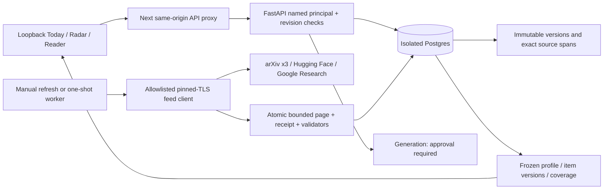

# Durable local workspace walkthrough

Implementation batch: 2026-11-02. Based on preview PR #281 (`11154b7`, including
the verified CI repair). This is the real metadata/manual-reading stage; owner
experience acceptance and paid generation remain pending.

## Run locally

From the follow-up worktree, with Docker Desktop running and the locked Python
environment available:

```bash
cd /private/tmp/arxiv-agent-eng-workspace-live
cd web
npm ci --ignore-scripts
cd ..
bash scripts/workspace-local.sh run
```

Open **http://127.0.0.1:3137/workspace/today** on desktop or in a 390 px browser
viewport. Only loopback addresses bind. The launcher creates a local-only API
credential in `outputs/workspace-live/.api-key` with private file permissions;
the stable principal is `personal-local`. Credentials stay in the Next server
and API environment. No login/account system or multi-device sync is implied.

The launcher always supplies the disabled model key and keeps schedule
activation off. It starts only Compose project `arxiv-workspace-live`, whose
Postgres port is 15438, database `workspace`, and volume
`arxiv-workspace-live_workspace-data`. Existing services and the owner's
checkout are untouched. Stop the foreground app with Ctrl-C. Storage remains;
`bash scripts/workspace-local.sh stop-storage` stops this project's container
without deleting its volume. Do not add `-v` to that command for routine use.

Separate commands, while storage is available:

```bash
bash scripts/workspace-local.sh refresh
bash scripts/workspace-local.sh worker-once
```

Refresh performs bounded public metadata reads. The worker runs once and
normally reports idle: the recurring schedule is intentionally disabled.
The first preview remains at `/today`, `/interests` and `/library` on a runtime
with `WORKSPACE_PREVIEW=1`; its banner says fictional. Live routes never use
those fixtures to fill an outage or an empty result.

## Desktop/mobile route through the application

1. **Interests:** edit the supplied core briefing, Rocket Twin and spatial
   exploration streams, topic selections, custom terms, exclusions, question
   and 5/15/45-minute preference. Saving creates a revision; a concurrent edit
   returns a conflict rather than silently replacing either version.
2. **Today:** inspect the five actual source receipts. Check sources manually
   if desired. The finite edition uses five-minute metadata reading slots,
   with deterministic term/question matches and a bounded exploration slot.
   These are planning estimates, not measured reading times or usefulness.
3. **Reader:** open an arXiv abstract or an honestly labelled publisher feed
   excerpt. The source link, exact observed version and material scope remain
   visible. Select text to attach a question/note/action to actual offsets.
   Save it and return via Library. A changed source version retains the old
   note and reading anchor; choosing a new version is explicit.
4. **Recovery:** a failed save keeps the text in the open reader and in the
   account/work/version-scoped browser session draft. Reload recovers it as
   **unsaved**. Retry only after reconnecting; a 409 needs explicit reconciliation.
5. **Radar/Library:** source/date/access/read-state filters and stable cursor
   pages inspect the actual database. Save, dismiss, snooze and undo persist.
   Pagination freezes the actual visible rows in an owner-scoped 24-hour
   snapshot, including read state. A late ingestion commit cannot insert itself
   between pages. Expired cursors require a fresh filter query; snapshots are
   capped at 2,000 results/4 MiB and are separate from permanent notes.
   Library exports authored text with work IDs, source URLs, versions and
   anchors. Saving an unsupported DOI/URL preserves a private link-only record;
   no paywall access or arbitrary URL fetch is attempted. A known arXiv ID
   reuses an already acquired canonical work/version.
6. **Sources & checks:** inspect bounded windows, request counts, real failures,
   Retry-After, last success, tasks and the proposed local time. Saving the time
   keeps recurrence disabled. No external destination exists.

## Explicit preview import

Old preview port 3127 and new live port 3137 are different browser origins.
The app cannot read another origin's storage. In the updated fixture Library,
**Download preview JSON for explicit import** preserves the complete original.
On the live Library, choose that file or paste its JSON, inspect the import
preview, and choose whether to import profile preferences as well as notes.
The server compares the preview digest and profile revision before applying.

Import IDs make retries safe. A changed browser note conflicts with the saved
entry and is not overwritten. Imported fictional sources stay labelled
`fixture`/`preview-import`, are private to their owner, and never enter live
editions. Neither successful import nor failure deletes the browser original
or original downloaded file. Markdown export remains available independently.

## Observed source receipt

Browser write tests use timestamped QA questions. Their examples are retained
in test artifacts rather than treated as the owner's notes or usefulness
labels. For a later browser write-test run, stop the default launcher and use
`WORKSPACE_OWNER=workspace-verification bash scripts/workspace-local.sh run`.
This uses a separate private namespace over the same public metadata. Restart
the default launcher afterward to return to `personal-local`; changing the
operator identifier never moves existing notes between owners.

The first integrated check at 2026-11-02T15:55Z made **five requests** and stored
**83 logical works**: three arXiv feeds capped at 25 each, seven Hugging Face
posts and one Google Research post. All three arXiv receipts are partial due
to truncation. Replaying the captured normalized records made **zero requests**
and retained **83 works**, with 83 immutable material records. This is an
observation of current feed contents, not exhaustive seven-day coverage.

Local evidence, intentionally excluded from Git:

- `outputs/workspace-live/real-intake-receipt.json`: source IDs, item counts,
  timestamps, status, HTTP count and actual requested/observed windows.
- `outputs/workspace-live/real-intake-replay.json`: captured public metadata,
  replay counts and zero-network proof. It contains no authored notes.
- `outputs/workspace-live/ranking-owner-labels.json`: chronological, keyword
  and lexical rankings on the same candidates; all usefulness labels are null.
- `web/build/workspace-live/`: real API desktop/mobile traces, screenshots and
  Markdown exports. Deliberate save failure is the only intercepted request.

arXiv RSS dates are announcement/update dates; original publication remains
unknown when the feed does not establish it. Hugging Face currently provides
link/metadata items, and Google's feed may supply only a short excerpt.
Neither is presented as an article body. Returned feed dates do not prove a
complete requested window; conditional 304 means unchanged feed bytes only.
Failed/truncated pages never advance a successful complete-window watermark.

## Actual data path



Scheduling uses short leased tasks and owner/date occurrence keys, first fold
on repeated DST hours and next valid minute in a DST gap. A 72-hour absence
creates one bounded catch-up task, not a backlog of deliveries. Publication and
its in-app intent commit together, fenced by the lease; pausing cancels queued
and running work. The controlled tests prove these properties. No recurring
worker has been activated for the owner.

## Backups, restore and rollback

Migrations are separate checksum-locked SQL files, applied under a Postgres
advisory lock. Never edit an applied file; add a new migration. A code rollback
can turn off `ENABLE_WORKSPACE`/`WORKSPACE_LIVE` and leave the additive tables
and volume intact. It does not require dropping personal records.

Create a private database backup with `umask 077` and the explicit project:

```bash
umask 077
docker compose -p arxiv-workspace-live -f compose.workspace.yml exec -T postgres \
  pg_dump -U workspace workspace > outputs/workspace-live/workspace-backup.sql
```

Restore into a **new disposable database** before replacing an existing one;
verify work/version counts, owner-scoped notes, revisions and source hashes.
The backup contains private data and must not be committed. A versioned API
export is available from `python -m src.workspace export --owner personal-local`
with the same environment as the launcher. The UI Markdown export is portable
reading context; it is not a complete database backup.

## Deliberate limits

This batch does not establish the 60-record identity qualification set, the
owner's 50 usefulness labels, the 14-day pilot, a measured production latency
SLO, or screen-reader acceptance. Manual DOI/URL saves do not discover metadata
or merge preprint/journal identities without reliable evidence. There is no
general article crawler, OCR, inline PDF viewer, external delivery or enabled
generation executor. Bounded PDF extraction accepts supplied permitted bytes;
its real extraction tests use synthetic PDFs, not a new scientific full-text
acquisition. Those boundaries remain in the implementation sequence.

The supported production launcher uses Next.js standalone output and copies the build static assets. Use `bash scripts/workspace-local.sh dev` for development. A later date-normalization replay added75metadata revisions without additional HTTP reads, retaining83logical works and all earlier source versions. The snapshot/cache and scheduler regression tests include uncommitted ingestion, import anchor/source changes, queued-before-sleep and actual concurrent workers.
