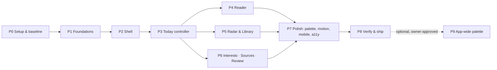

# 05 · Phases and work orders

There are ten phases, P0 to P9. P9 is optional and needs separate
approval. Each phase ends at a **gate** ([06](06-gates-and-verification.md)).
Do not start a phase until the previous gate is green.

- **One commit per work order.** Use a conventional message, e.g.
  `feat(workspace): …` or `test(workspace): …`, and end it with the session
  trailer the owner's environment requires.
- **Push after each gate.**
- **Update [STATUS.md](STATUS.md) at every gate:** what landed, the commit,
  measurements, deviations.

P4, P5 and P6 own disjoint component files, so they **may run in parallel**
(separate worktrees). They share `controller.css`. To avoid conflicts, each
work order appends to **its own fenced section** of `controller.css`, e.g.
`/* == P5 radar/library == */`. Do not edit another phase's section.

---

## P0: Setup and baseline (half a day)

### WO-0.1 Branch and baseline checks
- **Do.**
  - Check out `claude/youthful-dirac-69v19d`, or the branch the owner names.
  - Confirm the HEAD contains `planning/12-workspace-controller-revamp/`.
  - `cd web && npm ci`.
  - Run `npm run lint`, `npm run typecheck`, `npx vitest run` and
    `npm run budgets`. The last one builds.
- **Record** in STATUS.md: test-file count, test count, and every budget row
  measurement. The expected baseline is 53 workspace-related files and 1,417
  tests on the subset, and the full suite must pass.
- **Acceptance.** All green, numbers recorded.

### WO-0.2 Local stack and "before" captures
- **Do.**
  - Follow [08-local-stack.md](08-local-stack.md) §1–6.
  - Seed `workspace_rich` with `WORKSPACE_MINUTES=45`, which gives 9 items.
  - Capture all 7 routes × desktop and mobile × light and dark into
    `$WORK/before/`. The kit already holds five light captures in
    `evidence/before/`.
  - Run the live e2e suite (§7) against the `workspace` DB. Record the
    pass count; expect 16/16.
- **Acceptance.** The stack runs, before screenshots are reviewed, and the
  live e2e baseline is recorded.

**Gate G0.**

---

## P1: Foundations (palette, icons, mascot, cover tiles, queue logic)

### WO-1.1 Scoped palette
- **Owns:** `app/tokens.css` (append-only fence at the end), and a new
  `tests/workspace/palette.test.ts`.
- **Do.**
  - Append the fence from [02 §1](02-design-system.md#1-where-the-tokens-live-mechanics)
    with all values from [02 §2.1](02-design-system.md#21-role-table): the
    23 `--color-*` roles plus the `--ws-*` variables, in light, dark-attribute
    and dark-media variants.
  - Update the header comment of `tokens.css` (`:16-22`) to mention the
    scoped fence.
  - Write the **contrast test**. Parse the fence from `tokens.css`; assemble
    expected hex strings so the literal scan doesn't fire; assert every pair
    in [02 §2.3](02-design-system.md#23-contrast-floors-computed-2026-11-03-re-verify-in-a-unit-test)
    meets its floor in both themes.
  - Assert that the dark-attribute and dark-media blocks are identical.
- **Acceptance.**
  - `npx vitest run tests/tokens.test.ts tests/storybook.test.ts tests/shell tests/primitives tests/fonts.test.ts tests/workspace/palette.test.ts`
    is green.
  - The new test fails if any pair drops below its floor. Prove it once by
    mutating a value locally.

### WO-1.2 Icons, Mascot, CoverTile
- **Owns:**
  - `components/workspace/{Icon,Mascot,CoverTile}.tsx`
  - the `P1` section of `components/workspace/controller.css`
  - `lib/workspace/queue.ts` (`coverSeed` only)
  - tests `tests/workspace/{mascot,cover}.test.tsx`
- **Do.** Implement per [02 §5–7](02-design-system.md#5-iconography). The
  mascot builds paths from the grid; its moods are `data-mood` and CSS.
  Cover tiles use FNV-1a and `data-pattern` / `data-turn` / `data-invert`.
- **Tests.**
  - Mascot: renders `aria-hidden`, 5 paths, the mood attribute, no `<style>`.
  - Cover: deterministic for a given `work_id`, distribution across 6
    patterns over 100 ids, monogram extraction (skips stop-words, handles
    punctuation and unicode).
- **Acceptance.** Lint clean, including the no-hex and no-`font-family`
  rules; tests green.

### WO-1.3 Queue and URL logic
- **Owns:**
  - `lib/workspace/queue.ts`: `todayQueue`, `libraryQueue`, `resolveFocus`,
    `neighbours`, `readerTarget`
  - `lib/workspace/urlState.ts`
  - `lib/workspace/commands.ts`
  - `lib/workspace/api.ts` (`normalizeReaderReturnTo` focus support)
  - tests `tests/workspace/{queue,urlState,commands}.test.ts`, plus
    additions to `api.test.ts`
- **Do.**
  - Extract Today's inline derivation (`Today.tsx:33-62`) **verbatim in
    behaviour** into `todayQueue`, and the WorkCard target rule
    (`WorkCard.tsx:26-32`) into `readerTarget`.
  - Implement `resolveFocus` rules 1–3.
  - Implement `useQueryParam` and `setQueryParam`.
- **Tests.** 100% line and branch coverage of these modules, covering:
  - pinned versions;
  - missing pinned version (item dropped);
  - snoozed in the past or future;
  - dismissed and archived;
  - a focus id that was just dismissed (moves to next, or previous if it
    was last);
  - an unknown focus id;
  - popstate updates;
  - `return_to` with focus, both valid and hostile.
- **Acceptance.** Tests green; `LiveToday` is not yet changed.

### WO-1.4 Budget headroom
- **Owns:** `components/workspace/workspace.css` (deletion, later),
  `budgets.json`, `tests/budgets.test.ts`.
- **Do.** Nothing yet, unless P1's CSS already breaches. Measure with
  `npm run budgets` and record the result. Apply the ratchet
  ([04 §6](04-architecture.md#6-budgets)) **only** when a breach is real.
  It is normally done once, in P7 or P8, against final CSS.

**Gate G1.**

---

## P2: The Shell (IDE layout, slots, keyboard, drawer, status line)

### WO-2.1 Shell and slots
- **Owns:**
  - `components/workspace/Shell.tsx`
  - `components/workspace/Slots.tsx`
  - the `P2` section of `controller.css`
  - `tests/workspace/shell.test.tsx` (new)
  - updates to `experience.test.tsx:122-135` and `routes.test.tsx:56-75`,
    only if needed
- **Do.**
  - Build per [03 §1–2](03-screens-and-flows.md#1-shell-anatomy) and
    [04 §2–3](04-architecture.md#2-shell): brand with Jazzy, the six nav
    rows (Review added), the sidebar slot, the footer (export, Fictional
    preview, Research a question, Shortcuts, ThemeToggle, storage line), the
    stage header with breadcrumb and status line, the bar slot as the last
    child of `main`, and the mobile drawer.
  - Import `controller.css`. Keep importing `daily.css` until no live
    component uses `daily-*` classes. It costs zero emitted bytes because
    the preview emits it anyway.
- **Tests.**
  - Exactly one nav with that label, holding one `/Radar/` link.
  - The "Fictional preview" link points to `/today`.
  - One `main#main`, and no `h1` in the Shell.
  - The status-line text is present.
  - `SidebarSection` renders inline without the Shell, into the slot with
    the Shell, and never twice.
  - The drawer toggles `aria-expanded`; Esc closes it.
- **Acceptance.** Every existing Shell assertion in
  [07](07-test-impact.md) §3 is green.

### WO-2.2 Keyboard and command plumbing
- **Owns:**
  - `lib/workspace/commands.ts` (keymap)
  - the `useWorkspaceShortcuts` hook, in `Shell.tsx` or its own file
  - `Composer.tsx`
  - `tests/workspace/shortcuts.test.tsx`
- **Do.**
  - Wire the global keydown handler per [04 §5](04-architecture.md#5-commands-shortcuts-and-palette-one-mechanism)
    and the map in [03 §1.4](03-screens-and-flows.md#14-global-keyboard-map).
  - `/` focuses the composer.
  - Enter in the composer navigates to Radar with `q`.
  - `/`-prefixed text runs a command.
- **Tests.**
  - Keys click the matching `[data-command]` button.
  - Keys are ignored inside inputs, textareas and selects.
  - Disabled buttons are not clicked.
  - `g` then `l` navigates; `location.assign` is stubbed.
  - The composer submits to Radar.
- **Acceptance.** Tests green; no lint warnings.

**Gate G2.** All routes still render inside the new Shell, even with old
page content.

---

## P3: Today becomes the controller (the heart of the request)

### WO-3.1 Focus stage and queue
- **Owns:**
  - `components/workspace/{Today,FocusPaper,Queue,PlayerBar}.tsx`
  - the `P3` section of `controller.css`
  - Today tests in `experience.test.tsx` and `stage1.test.tsx`, plus a new
    `tests/workspace/today-controller.test.tsx`
- **Do.**
  - Implement [03 §3](03-screens-and-flows.md#3-today-the-focused-paper)
    completely:
    - `todayQueue` plus `resolveFocus(useQueryParam("focus"))`;
    - `FocusPaper` (cover, chips, `h3` link, full abstract, why, evidence);
    - sidebar sections: Up next, Reading time, Source checks, Your
      question, Generation, links;
    - `ControlBar` with `PlayerBar`;
    - the resume strip and Edition details in the stage;
    - empty states with Jazzy.
  - Today's status buttons now live **only** in the bar, with the existing
    accessible-name prefixes.
- **Tests.**
  - Update the existing ones per [07](07-test-impact.md) §2.
  - **New multi-item fixture** with 4 works in `editions[0].work_ids`.
    Assert:
    - queue order equals edition order;
    - the first item is focused by default;
    - Next and Prev change the focused title and `?focus`;
    - `j` and `k` work;
    - Dismissing the focused item moves focus to the next one, and Undo
      brings it back into focus;
    - Snooze behaves the same way;
    - the last item's Next is disabled;
    - a reload with `?focus=` keeps it;
    - popstate updates the focus;
    - queue rows are buttons named "Show paper N of M: …", with
      `aria-current` on the focused row;
    - exactly one `<article>`, and none in empty states;
    - exactly one `role=status`;
    - the abstract text appears once.
- **Acceptance.**
  - All of `tests/workspace` is green.
  - With the local stack (rich DB, 9 items), stepping through all 9 papers
    by keyboard works.
  - On mobile the focused title sits above y = 800.

### WO-3.2 Today visual pass
- **Do.**
  - Pixel-polish against [02](02-design-system.md):
    - the red wash header;
    - cover hero sizing;
    - title scale;
    - the abstract measure;
    - bar spacing;
    - the equalizer;
    - hover, focus and active states;
    - dark and light.
  - Capture desktop and mobile in both themes. Compare against
    `evidence/before/desktop-today.png` and the wireframe.
- **Acceptance.** Self-review checklist [06 §3](06-gates-and-verification.md#3-visual-qa-checklist)
  passes for Today.

**Gate G3.** Push. This is the first owner-visible milestone. If possible,
send the owner the Today screenshots, dark and light, desktop and mobile.

---

## P4: Reader in the controller frame

### WO-4.1 Reader layout and edition navigation
- **Owns:**
  - `components/workspace/{Reader,RetainedSource,SyntheticWorkbench}.tsx`
  - the `P4` section of `controller.css`
  - reader tests in `retained.test.tsx`, `synthetic.test.tsx` and
    `experience.test.tsx`, plus a new `reader-controller.test.tsx`
- **Do.** Implement [03 §4](03-screens-and-flows.md#4-reader-workspaceitemsid).
  - **Sidebar:** back link, Up next (from `return_to`), tab outline, version
    info.
  - **Bar:** prev/next reader URLs plus the reader's own actions.
  - Keep the tab ids `source`, `understand` and `notes`.
  - Keep all reader copy, drafts and conflict flows.
  - Read the fragile list in [recon/03-reader.md](recon/03-reader.md) §5
    first.
- **Tests.**
  - Prev and next hrefs are correct for the Today queue and the Library
    view.
  - Existing reader tests are green.
  - Tab order: at most 16 Tabs from `main` to "Your notes". This is
    verified by the live e2e run.
- **Acceptance.** `live.spec` reader flows pass on the local stack.

**Gate G4.**

---

## P5: Radar and Library

### WO-5.1 Radar
- **Owns:** `Radar.tsx`, the `P5` section of `controller.css`, Radar tests.
- **Do.** Implement [03 §5](03-screens-and-flows.md#5-radar).
  - Filters and the results queue go in the sidebar.
  - The stage shows the focused result.
  - `focus` joins Radar's URL params.
  - The composer drives `q`.
  - Next-page from the bar works.
- **Acceptance.** Radar tests are green, plus new ones for focus and
  pagination.

### WO-5.2 Library and Import
- **Owns:** `Library.tsx`, `Import.tsx`, `WorkCard.tsx` (restyle), Library
  tests.
- **Do.** Implement [03 §6](03-screens-and-flows.md#6-library).
  - View chips (or a select) go in the sidebar.
  - The stage shows the focused work plus its notebook entries.
  - Quick add and Import go in the sidebar.
  - Choose and **document in STATUS** whether Save/Unsave lives on the card
    or in the bar on this route.
- **Acceptance.** Library tests (including `/^Unsave …/`) are green, and
  the notes-view return from the reader is preserved
  (`experience.test.tsx:1054-1069`).

**Gate G5.**

---

## P6: Interests, Sources & checks, Review

### WO-6.1 Interests
- **Owns:** `Interests.tsx`, `InterestCoverage.tsx`, Interests tests.
- **Do.** Implement [03 §7](03-screens-and-flows.md#7-interests): a section
  index in the sidebar, a grouped form in the stage, and save/discard in the
  bar.
- **Acceptance.** Interests tests are green, and the draft and conflict
  flows are unchanged.

### WO-6.2 Sources & checks
- **Owns:** `Operations.tsx`, its tests.
- **Do.** Implement [03 §8](03-screens-and-flows.md#8-sources--checks-operations):
  a sources queue with status words, the focused source detail, and the
  schedule form.
- **Acceptance.** Operations tests are green.

### WO-6.3 Review
- **Owns:** `CandidateReview.tsx`, `review.test.tsx`.
- **Do.** Implement [03 §9](03-screens-and-flows.md#9-review-candidate-usefulness):
  - the packet controls and candidate queue (with label chips) in the
    sidebar;
  - the focused `CandidateFeedback` in the stage, with its native radios;
  - keys `1`, `2` and `3`.
- **Acceptance.** All 418 lines of `review.test.tsx` semantics are
  preserved; new tests cover focus and keys.

**Gate G6.**

---

## P7: Polish (palette, motion, mobile, accessibility, delight)

### WO-7.1 Command palette and shortcuts dialog
- **Do.**
  - Build a lazy `CommandPalette` and `ShortcutsDialog` per
    [03 §11](03-screens-and-flows.md#11-command-palette-k) and
    [04 §5](04-architecture.md#5-commands-shortcuts-and-palette-one-mechanism).
  - Measure first-load JS before and after; the palette must not count
    toward first load.
- **Tests.**
  - It opens with ⌘K and Ctrl+K.
  - It lists the enabled page commands.
  - Filtering, Enter and Esc work, and focus returns to the invoker.

### WO-7.2 Motion and delight
- Stage cross-fade, equalizer, mascot moods (busy during saves and checks,
  sleepy on empties, alert on outage), and the hover reveal on queue rows.
- **Verify:** emulate `prefers-reduced-motion: reduce` in Playwright and
  confirm all animation stops.

### WO-7.3 Responsive and theme QA
- Go through every route at 390, 768, 1024, 1280 and 1440 widths, in dark
  and light.
- Fix overflow and wrapping.
- Make sure there is no horizontal page scroll, the drawer focus trap
  works, and targets are 44px on coarse pointers.

### WO-7.4 Accessibility pass
- Run axe (`@axe-core/playwright`) on all routes in both themes, at desktop
  and mobile widths. The result must be zero serious or critical issues.
- Do a keyboard-only walkthrough of the full daily loop: Today → step
  through → open reader → save question → back → next.
- Fix everything found.

### WO-7.5 Budgets
- Run `npm run budgets`.
- Reduce first ([04 §6](04-architecture.md#6-budgets)).
- If any row still breaches, apply the pre-authorized ratchet with recorded
  numbers. Stop and ask if a cap would be exceeded.

**Gate G7.**

---

## P8: Verify and ship

### WO-8.1 Full verification
1. `npm run lint && npm run typecheck && npx vitest run`.
2. `npm run test -- --coverage`. It must meet the global thresholds
   (lines 99.11, statements 98.15, branches 94.0, functions 91.8).
3. `npm run budgets`.
4. Bring up the local stack. Run the live e2e suite; it must be **16/16 or
   better**, with specs updated only where they pinned old layout, and each
   change justified in STATUS.
5. Capture "after" screenshots: 7 routes × 2 themes × 2 widths, at
   `deviceScaleFactor: 2` for the owner. Save them to `evidence/after/`.
6. Optionally regenerate the `workspace-e2e/daily.spec.ts` preview checks.
   They must be unaffected. Run them if the preview tier can boot
   (`playwright.workspace.config.ts`).

### WO-8.2 Independent review
- Run an adversarial review of the full diff with fresh reviewers who are
  not given your conclusions. Use these lenses:
  1. product-truth regressions (copy, request bodies, honesty states);
  2. accessibility;
  3. React and lint correctness (effects, refs, stale closures);
  4. visual fidelity to [02](02-design-system.md) and [03](03-screens-and-flows.md);
  5. budgets and CSP.
- Fix the confirmed findings.

### WO-8.3 Ship
- Update STATUS.md: the final timeline, measurements, screenshots,
  deviations and follow-ups.
- Push the branch. **Do not open a PR unless the owner asks.** If asked,
  the PR body links this kit, lists before and after screenshots, and states
  any budget ratchets.

**Gate G8: Definition of Done** ([06 §4](06-gates-and-verification.md#4-definition-of-done)).

---

## P9: Optional, separately approved (not part of this assignment)

- **P9.1** Extend the palette app-wide: Evidence Workbench, learn routes and
  the fictional preview. This means editing the four global theme blocks,
  `tokens.json` and contrast records; regenerating visual and README
  goldens (darwin baselines); and re-running axe baselines. It needs owner
  approval because it changes surfaces the owner did not ask about.
- **P9.2** Turn the bottom composer into a real **ask-about-this-paper**
  prompt once grounded generation is approved. That needs the spend
  approval packet in `planning/11-daily-research-workspace/15-…`.
- **P9.3** A right-hand context panel (Claude Code's "Plan" panel). The
  owner said "just one large sidebar **for now**".
